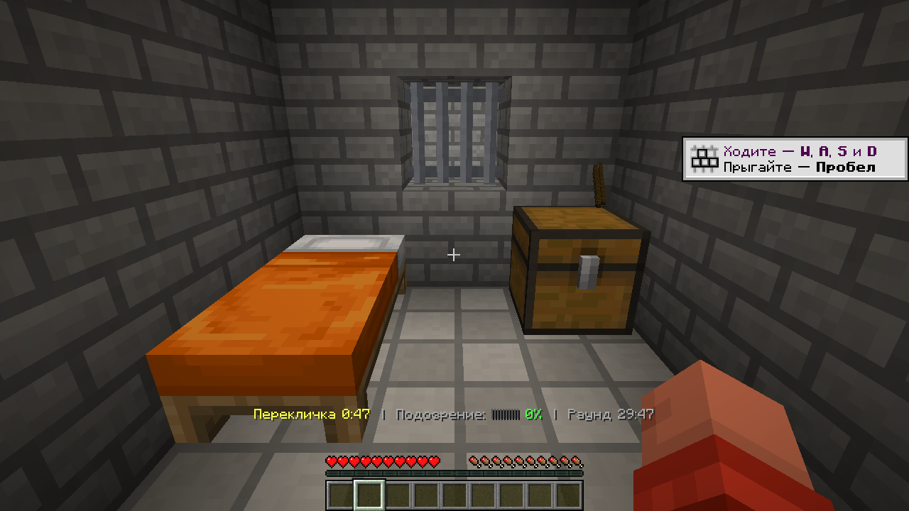
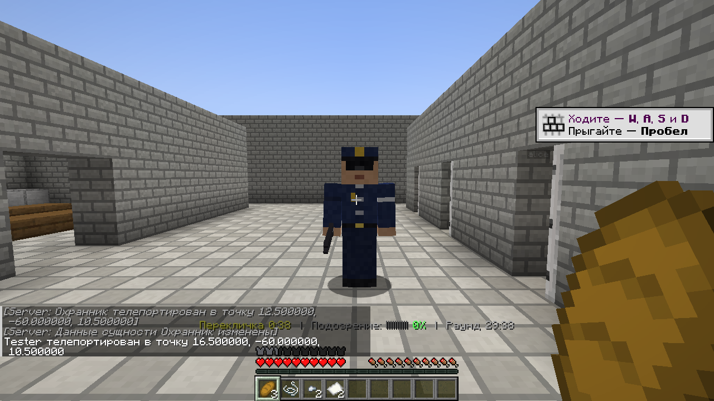
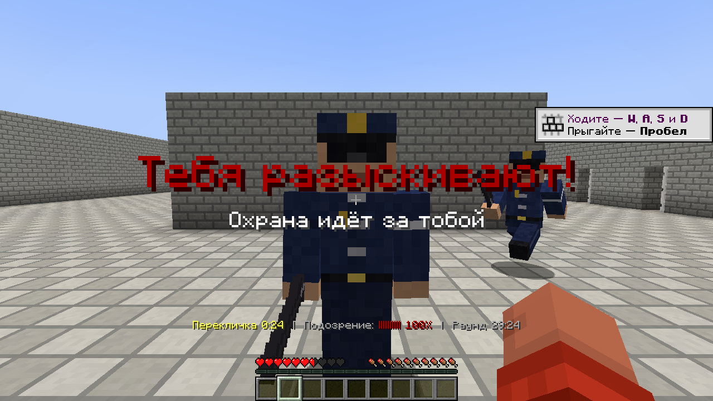
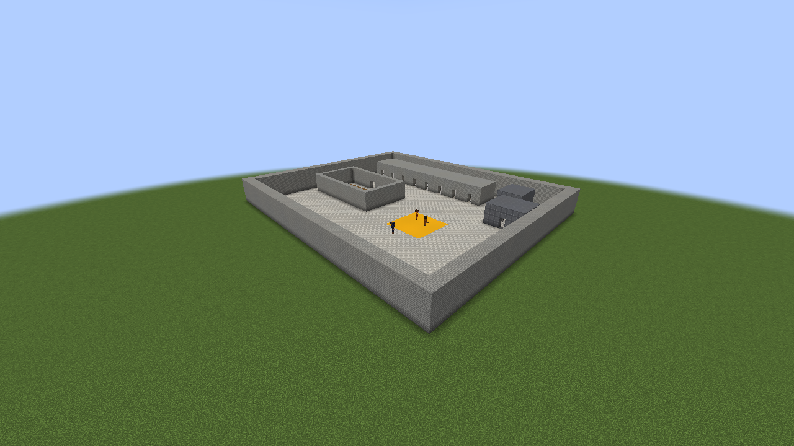
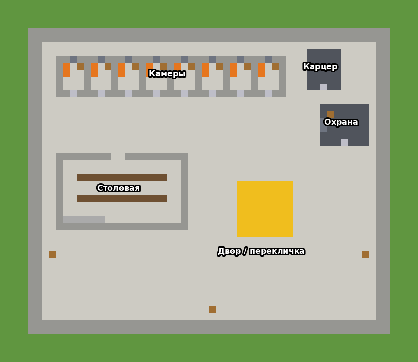

# Cellbreak: побег из тюрьмы в Minecraft

Мод для Minecraft Java 1.21.1 (Fabric) по мотивам The Escapists. Одни игроки сидят
в тюрьме и готовят побег, другие их охраняют. Если охранников-игроков мало, недостающие
посты занимают NPC-охранники.

| | |
|---|---|
|  |  |
|  |  |
|  |  |

Все текстуры и модели сделаны скриптом, ресурсов The Escapists в моде нет:

## Установка (нужна каждому игроку)

1. Minecraft **Java Edition 1.21.1**.
2. Установщик **Fabric Loader** с fabricmc.net: выбрать версию 1.21.1 и нажать «Install».
3. Мод **Fabric API** для 1.21.1 (Modrinth или CurseForge) положить в папку `mods`.
4. Файл `cellbreak-0.2.0.jar` из папки [`dist`](dist) положить туда же, в `mods`.
5. Запустить игру с профилем «fabric-loader-1.21.1».

## Как играть с друзьями

**Проще всего (без сервера).** Хост создаёт мир (лучше «Суперплоский»), открывает его
для сети («Открыть для сети», читы включены), а друзья подключаются:
- через мод **e4mc**: он сам выдаёт ссылку-адрес для друзей;
- или через **Radmin VPN / ZeroTier**: все в одной виртуальной сети, адрес как в локальной.

**Через сервер.** Сервер Fabric 1.21.1 (fabricmc.net → Server), в его `mods` кладутся
Fabric API и `cellbreak-0.2.0.jar`. Чтобы друзья зашли через интернет, удобно использовать
**playit.gg**. Чтобы вводить команды, хост должен быть оператором (`/op ник`).

## Команды

| Команда | Что делает |
|---|---|
| `/cellbreak build` | Строит тюрьму от точки, где вы стоите, на юго-восток (участок примерно 75×65). **Всё на этом участке стирается!** |
| `/cellbreak menu` | Кнопки выбора стороны в чате (появляются и сами при входе в мир) |
| `/cellbreak join prisoner\|guard\|random\|spectator` | Выбрать сторону: заключённый, охранник, случайно или просто смотреть |
| `/cellbreak role <ник> prisoner\|guard\|random\|spectator` | Назначить сторону другому игроку (оператор) |
| `/cellbreak leave` | Выйти из игры |
| `/cellbreak start [минуты] [NPC-охрана] [NPC-заключённые]` | Начать раунд. По умолчанию 30 минут, охрана подбирается сама, свободные камеры заполняются NPC (до 16) |
| `/cellbreak phase <этап>` | Сразу перейти к этапу распорядка (`work`, `lights_out`…) |
| `/cellbreak skip` | Перейти к следующему этапу распорядка |
| `/cellbreak stop` | Остановить раунд (тюрьма возвращается в исходное состояние) |
| `/cellbreak status` | Кто во что играет, подозрение заключённых |
| `/cellbreak tp` | Телепорт к тюрьме |

**Стороны.** Кто не выбрал сторону (или выбрал «случайно»), получает её при старте раунда
случайно: примерно один охранник на трёх заключённых, при двух игроках и больше охранник
будет всегда.

## Своя карта вместо сгенерированной

Мод работает и на готовых картах: части тюрьмы отмечаются командами (оператор). Координаты
можно писать числами или `~ ~ ~` (там, где стоите).

| Команда | Что отмечает |
|---|---|
| `/cellbreak map new` | Начать разметку заново |
| `/cellbreak map area <от> <до>` | Территорию тюрьмы вместе со стенами (можно несколько прямоугольников). За ней — побег |
| `/cellbreak map breakminy <y>` | Ниже этой высоты ломать нельзя (чтобы не докопаться до механизмов карты) |
| `/cellbreak map cell <точка>` | Камеру: встаньте внутри, мод сам найдёт стены, железную дверь и сундук-тумбочку |
| `/cellbreak map door <точка>` | Железную дверь, открытую днём и запертую на отбой |
| `/cellbreak map rollcall <от> <до>` | Место переклички |
| `/cellbreak map canteen <от> <до>` | Столовую |
| `/cellbreak map work <от> <до>` | Мастерскую (необязательно). Поставьте в ней `cellbreak:job_desk` и печь |
| `/cellbreak map supply <точка>` | Сундук со сырьём для работы (брёвна, руда, уголь) |
| `/cellbreak map yard <от> <до>` | Прогулочный двор (необязательно) |
| `/cellbreak map shower <от> <до>` | Душевую (необязательно) |
| `/cellbreak map sniper <точка>` | Пост снайпера (на вышке или стене; вокруг не должно быть ограждения выше пояса) |
| `/cellbreak map solitary <точка>` | Карцер (готовую комнату с железной дверью) |
| `/cellbreak map buildsolitary <точка>` | Построить карцер из усиленных блоков |
| `/cellbreak map guardroom <точка>` | Где появляются охранники-игроки |
| `/cellbreak map npcspawn <точка>` | Где появляется NPC-охрана |
| `/cellbreak map patrol <точка>` | Точку патруля NPC (лучше на каждом этаже и во дворе) |
| `/cellbreak map scrap <точка>` | Сундук или бочку с хламом для крафта |
| `/cellbreak map info` | Проверить, всё ли отмечено |

Этапы распорядка без своего места (нет мастерской, двора или душа) просто пропускаются.
Металлодетектор — блок `cellbreak:detector`, ставится в проходе (сквозь него можно ходить).

На готовых картах самодельная кирка ломает каменный кирпич (сначала трещина), напильник —
железные решётки, лопата — гладкий камень и землю. Ломать можно только внутри территории.
NPC не умеют лазить по приставным лестницам, поэтому если разыскиваемого только что
видели, но он залез туда, куда не дойти, охранник выходит к нему «служебным ходом».

## Правила

**Распорядок дня** (один «день» ≈ 12,5 минуты): утренняя перекличка → завтрак → работа →
свободное время → прогулка → душ → ужин → свободное время → вечерняя перекличка → отбой.
Звонит колокол, на экране написано, куда идти. Кто не пришёл, получает подозрение
(+40 за перекличку, +25 за остальное). За завтрак и ужин дают хлеб, душ лечит,
прогулка даёт силу и скорость на 2 минуты.

**Обыск на перекличке.** Охрана обыскивает четырёх случайных заключённых (и игроков, и
NPC). Нашли запрещёнку — карцер.

**Работа и деньги.** В мастерской склад с брёвнами, сырым железом и углём. Доски (крафт
из брёвен) и железные слитки (переплавка в печи) сдаются на столе сдачи работы:
4 доски = 1 монета, 1 слиток = 2 монеты. На входе в мастерскую стоит металлодетектор:
если пронести через него запрещёнку, сработает сирена и подозрение вырастет на 60.

**NPC-заключённые** живут в свободных камерах и ходят по распорядку. Торговцы
(с зелёной банданой и подписью «[торговец]») продают за деньги инструменты, муляжи,
ключи и материалы, а ещё покупают железные слитки. Остальные NPC просто болтают.

**Подозрение** (внизу экрана). Растёт, если охрана видит у тебя в руках запрещённый
предмет, видит, как ты ломаешь тюрьму, или застаёт тебя вне камеры после отбоя. Если
ударить охранника, подозрение сразу становится 100%. На 100% тебя объявляют в розыск.

**Розыск и укрытие.** Охрана узнаёт о розыске по рации и бежит туда, где тебя видели в
последний раз. Если тебя не видят, они ищут на месте, а не идут прямо к тебе. Чтобы
спрятаться: уйди из поля зрения, крадись (присед вдвое сокращает дальность, на которой
тебя видно), держись темноты или залезь в вентиляцию (там тебя видно только вплотную).
Если охрана не видит тебя 20 секунд, ты оторвался.

**Снайперы** стоят на вышках. Если ты на улице, где тебе быть нельзя (ночью — везде,
днём — не там, где положено по распорядку), снайпер тебя замечает (сразу розыск),
целится 2 секунды и стреляет. Попадание — карцер. Укрытие: крыша, стены, деревья.
После звонка есть 25 секунд, чтобы дойти до нужного места.

**Вентиляция** (в сгенерированной тюрьме — короб над камерами). Сними решётку в потолке
камеры напильником, освободи руку и нажми ПКМ по потолку короба — залезешь внутрь и
поползёшь. Короб выходит наружу через решётку в торце корпуса камер.

**Муляжи.** Охрана на обходе замечает дыры в стенах, полу, снятые решётки вентиляции
и трещины, заделывает их и поднимает тревогу (если дыра у тебя в камере — подозрение
+50). Чтобы спрятать дыру, возьми муляж в руку, посмотри на дыру и нажми ПКМ. Муляж
стены или пола выглядит как стена или пол, муляж решётки — как решётка вентиляции.
Снять муляж: пустая рука, присесть и ПКМ. Охранник-игрок может простучать муляж
дубинкой (ПКМ) — он развалится.

**Карцер.** Три удара NPC-охранника, наручники игрока-охранника, выстрел снайпера или
потеря сознания (смерти в игре нет) отправляют заключённого в карцер на 60 секунд.
Запрещённые предметы при этом изымаются.

**Побег.** Выбраться за внешнюю стену. Если сбежали все, побеждают заключённые. Если
время вышло, считается, сколько сбежало: половина и больше — победа заключённых.

### Самодельные инструменты и запрещённые предметы

Материалы лежат в тумбочках в камерах и в ящиках с хламом (пополняются на завтрак и ужин),
их же продают торговцы. Крафт можно делать прямо в инвентаре.

| Предмет | Рецепт | Что делает |
|---|---|---|
| Самодельная кирка | кремень + палка + нитка | Ломает стены: 8 секунд до трещины, ещё 8 до дыры. Хватает на 6 блоков |
| Самодельная лопата | железный самородок + палка + нитка | Пол — 6 секунд, земля — 2 секунды. 24 блока |
| Напильник | 2 железных самородка + палка | Решётка — 10 секунд, решётка вентиляции — 6 секунд. 4 блока |
| Заточка | кремень + бумага | Оружие |
| Ключ-слепок | глина + железный самородок + бумага | Открывает железные двери (камеры, карцер, комнату охраны) |
| Муляж стены или пола | 2 бумаги + глина | Прячет дыру в стене или полу |
| Муляж решётки вентиляции | бумага + железный самородок + нитка | Прячет снятую решётку вентиляции |

Всё это, а также дубинка и наручники, — запрещённые предметы для заключённых.
Деньги — нет.

В сгенерированной тюрьме внешняя стена толщиной 2 блока и уходит на 3 блока под землю.
Под тюрьмой 4 слоя земли, ниже камень. Карцер, комната охраны и вышки усилены, их сломать
нельзя.

### Охрана

Охранник получает дубинку, наручники и ключ. Наручники (ПКМ по заключённому) обыскивают
его: если нашлось запрещённое или он в розыске, он отправляется в карцер. Дубинкой (ПКМ)
можно простучать подозрительную стену. Охрана видит в строке внизу экрана, кто сейчас
в розыске.

## Для разработчиков

- Сборка: `./gradlew build` → `build/libs/cellbreak-0.2.0.jar`.
- Текстуры генерируются скриптом `tools/gen_textures.py`, превью рисует `tools/preview.py`.
- `./gradlew runTestServer` запускает сервер с тестовыми ботами (`src/testmod`, команды
  `/cbtest ...`). `./gradlew runTestClient` запускает клиент, который сам подключается к
  нему и делает скриншоты по командам из `run_client/client_cmds.txt`. В готовый мод
  тестовый код не попадает.
