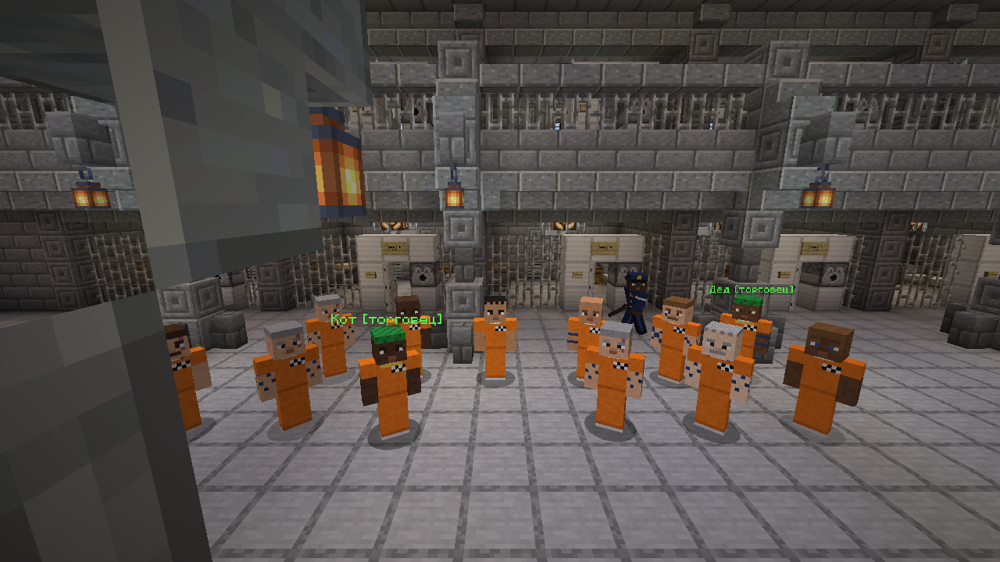
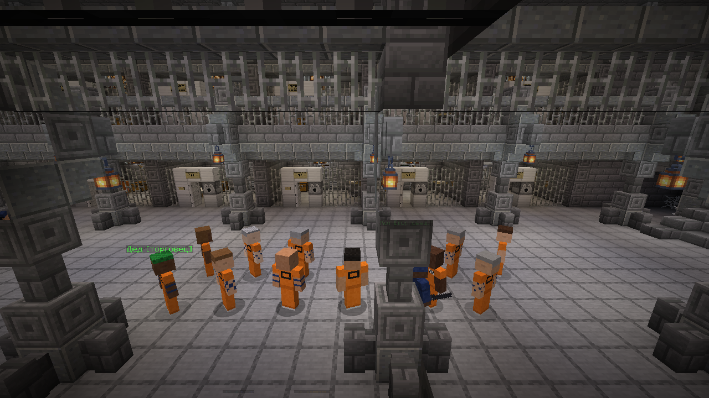
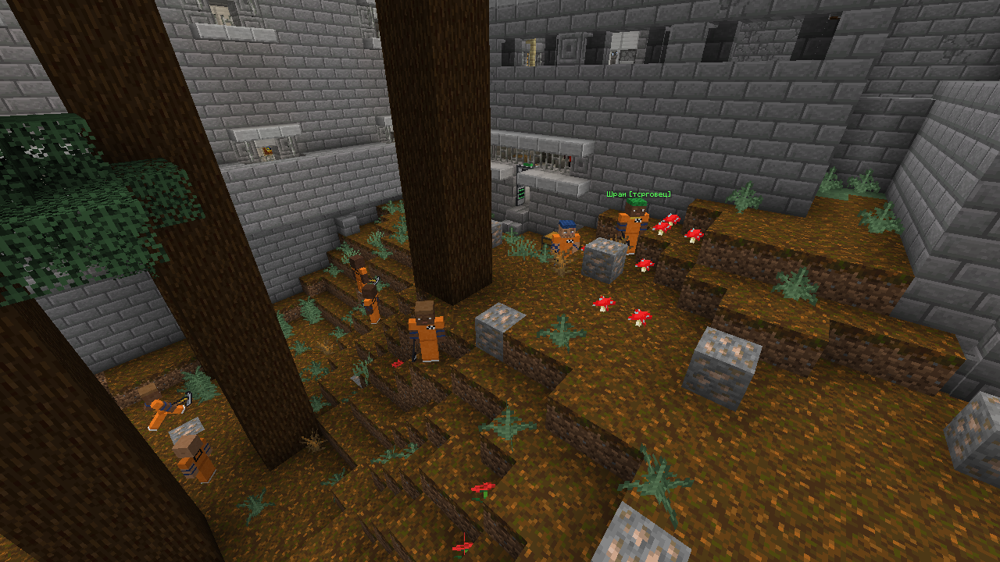
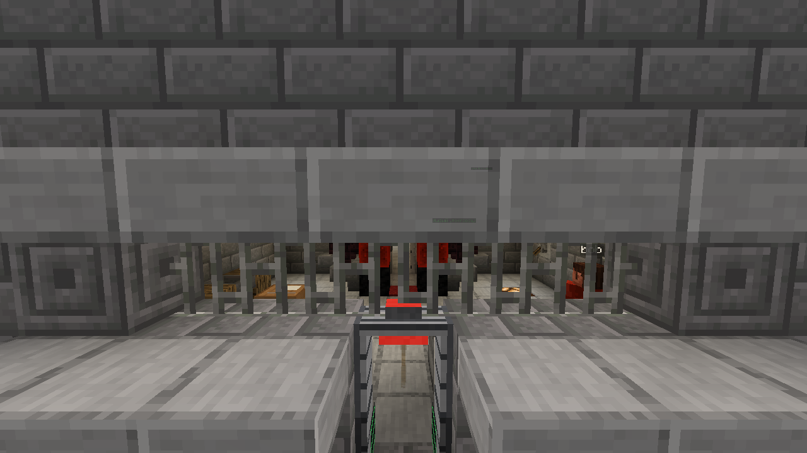
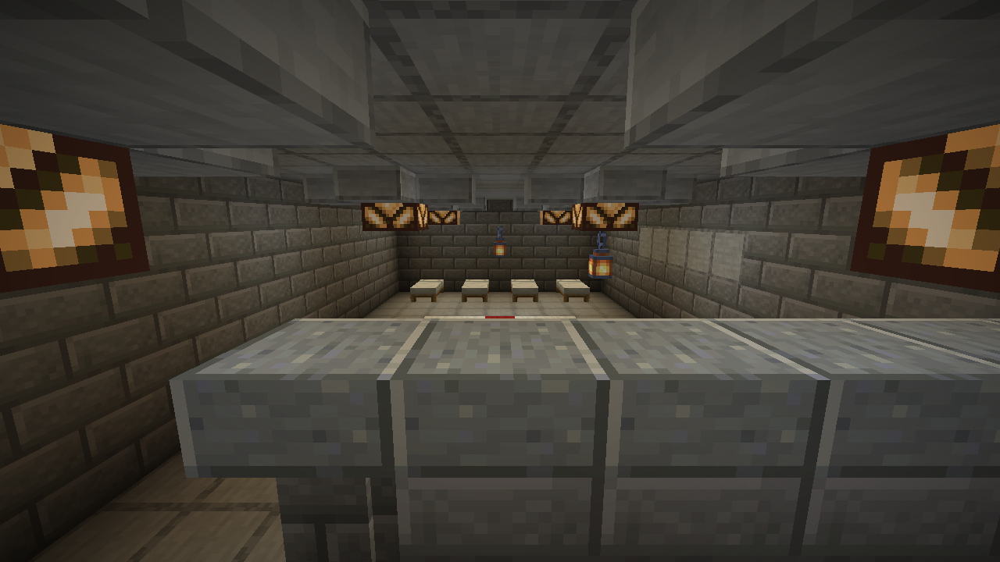
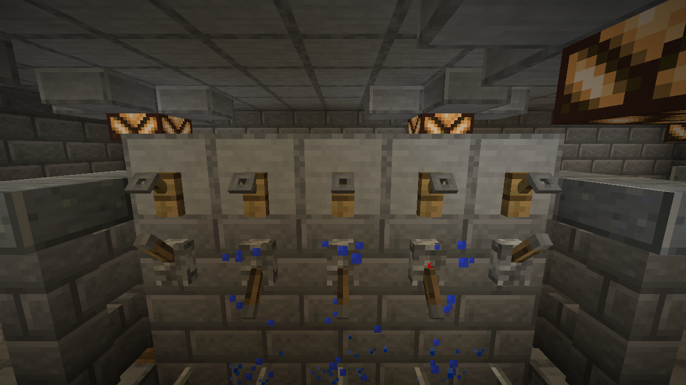
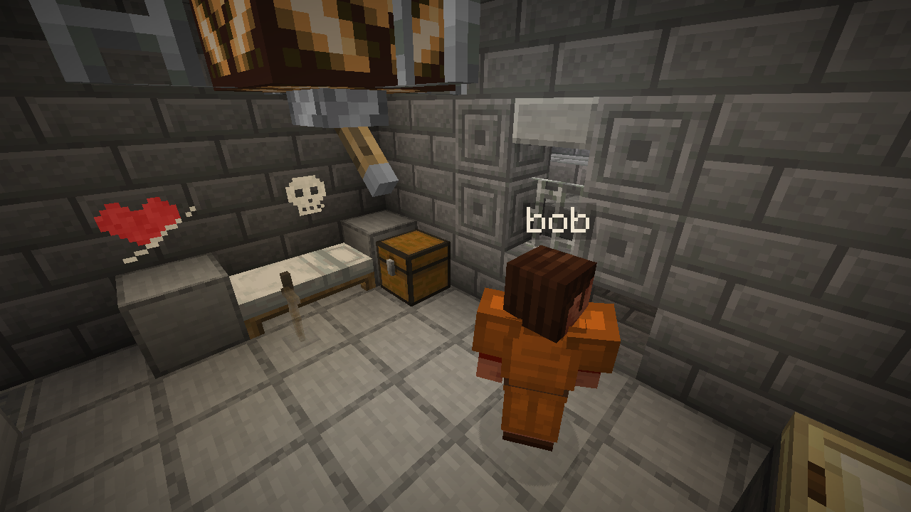
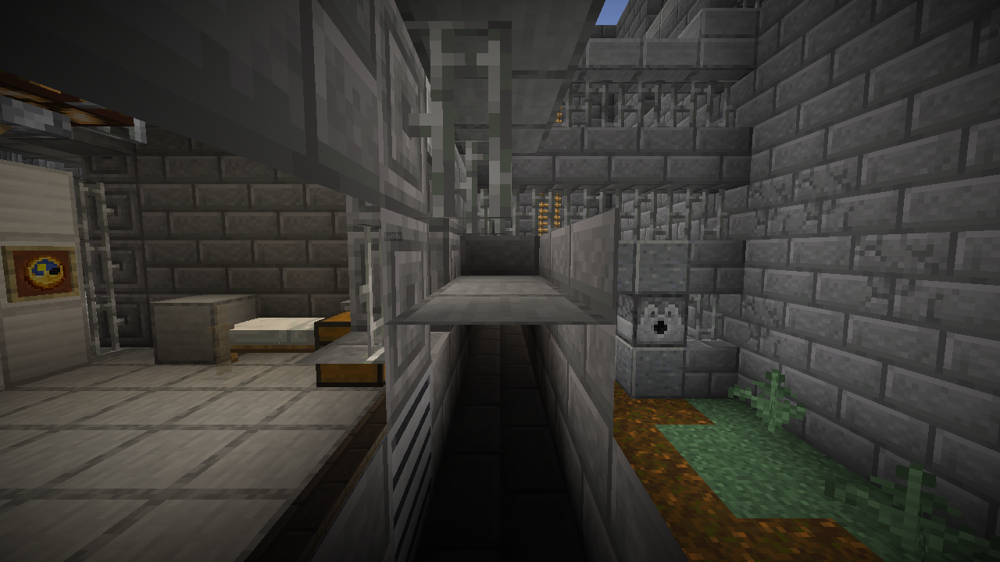
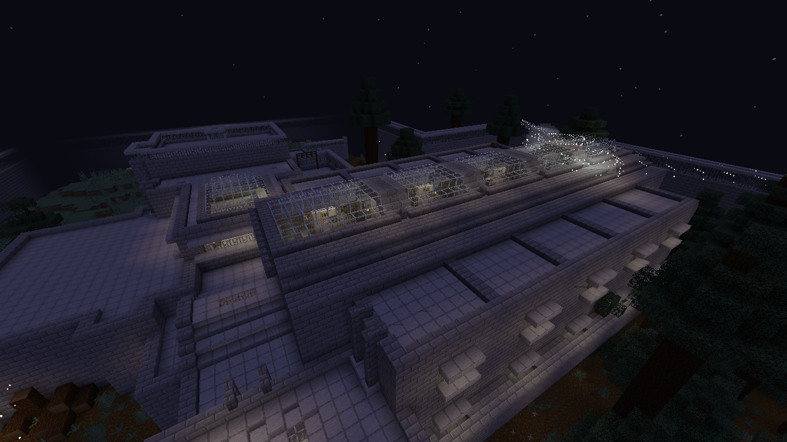
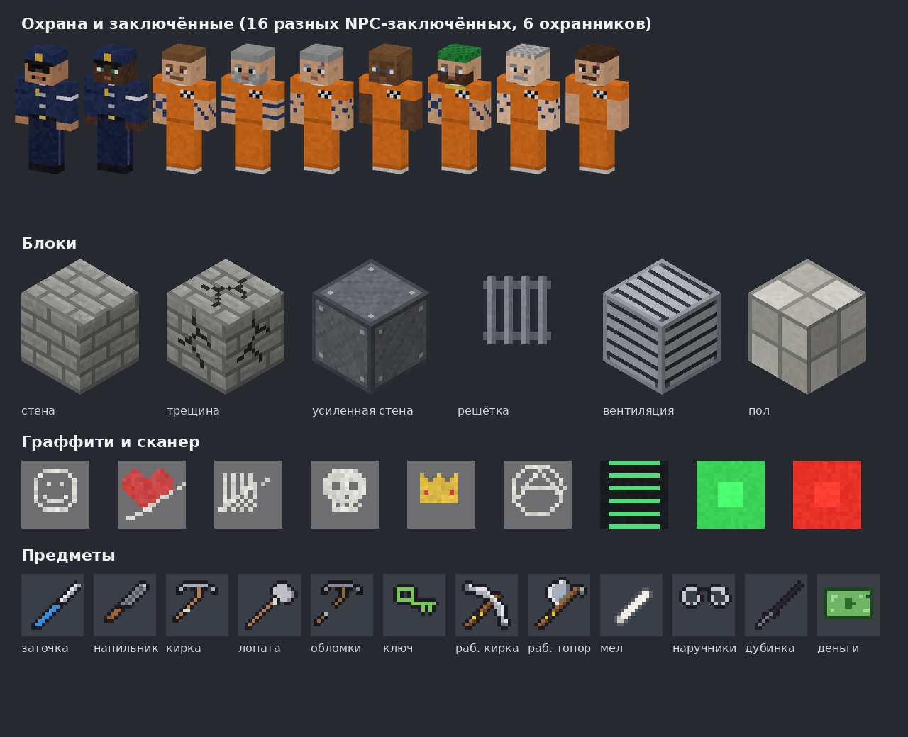

# Cellbreak: побег из тюрьмы в Minecraft

Мод для Minecraft Java 1.21.1 (Fabric) по мотивам The Escapists. Одни игроки сидят
в тюрьме и готовят побег, другие их охраняют. Если охранников-игроков мало, недостающие
посты занимают NPC-охранники, а свободные камеры заполняют NPC-заключённые.

Мод рассчитан на карту **MPE — Cellbreak** (переделанная Minecraft Prison Escape): на ней
уже всё размечено. Карта распространяется отдельно от мода, в этом репозитории её нет.

| | |
|---|---|
|  |  |
|  |  |
|  |  |
|  |  |
|  | |

Все текстуры и модели сделаны скриптом, ресурсов The Escapists в моде нет:

## Установка (нужна каждому игроку)

1. Minecraft **Java Edition 1.21.1**.
2. Установщик **Fabric Loader** с fabricmc.net: выбрать версию 1.21.1 и нажать «Install».
3. Мод **Fabric API** для 1.21.1 (Modrinth или CurseForge) положить в папку `mods`.
4. Файл `cellbreak-0.5.12.jar` из папки [`dist`](dist) положить туда же, в `mods`.
5. Запустить игру с профилем «fabric-loader-1.21.1».

## Как играть с друзьями

Хост распаковывает карту **MPE Cellbreak** в папку `saves` (или в папку сервера и пишет её
имя в `level-name` в `server.properties`).

**Проще всего (без сервера).** Хост открывает карту, затем «Открыть для сети» (читы
включены), а друзья подключаются:
- через мод **e4mc**: он сам выдаёт ссылку-адрес для друзей;
- или через **Radmin VPN / ZeroTier**: все в одной виртуальной сети, адрес как в локальной.

**Через сервер.** Сервер Fabric 1.21.1 (fabricmc.net → Server), в его `mods` кладутся
Fabric API и `cellbreak-0.5.12.jar`. Чтобы друзья зашли через интернет, удобно использовать
**playit.gg**. Чтобы вводить команды, хост должен быть оператором (`/op ник`).

## Команды

| Команда | Что делает |
|---|---|
| `/cellbreak menu` | Кнопки выбора стороны в чате (сами появляются при первом входе в мир и после каждого раунда) |
| `/cellbreak join prisoner\|guard\|random\|spectator` | Выбрать сторону: заключённый, охранник, случайно или просто смотреть |
| `/cellbreak role <ник> prisoner\|guard\|random\|spectator` | Назначить сторону другому игроку (оператор) |
| `/cellbreak leave` | Выйти из игры |
| `/cellbreak start [NPC-охрана] [NPC-заключённые]` | Начать раунд. Время не ограничено: игра идёт, пока все заключённые не сбегут (или пока хост не остановит). Охрана подбирается сама, свободные камеры заполняются NPC (до 16) |
| `/cellbreak phase <этап>` | Сразу перейти к этапу распорядка (`work`, `lights_out`…) |
| `/cellbreak skip` | Перейти к следующему этапу распорядка |
| `/cellbreak stop` | Остановить раунд (тюрьма возвращается в исходное состояние) |
| `/cellbreak status` | Кто во что играет, подозрение заключённых |
| `/cellbreak tp` | Телепорт к тюрьме |
| `/cellbreak donos <ник>` | Только для стукача: донести на заключённого (рядом должен быть охранник) |

**Стороны.** Кто не выбрал сторону (или выбрал «случайно»), получает её при старте раунда
случайно: примерно один охранник на трёх заключённых, при двух игроках и больше охранник
будет всегда.

## Правила

**Двери.** На подъёме всё заперто. Днём открыты камеры и внутренние двери, а двери на улицу —
только с прогулки до вечернего свободного времени; на вечерней перекличке их закрывают
через 15 секунд (успеть зайти). На прогулку выходят из главного зала через садик во двор,
дальше по тропинкам вдоль западной стены. Рабочее поле обнесено решёткой: с него на улицу
не выйти, только обратно через рамки в мастерскую. Кнопки и рычаги карты у дверей во время раунда не работают — двери
открывает только распорядок (и ключ). В чате при старте раунда видна версия мода — проверьте,
что стоит именно она.

**Время.** Внизу экрана — день и часы тюрьмы (подъём в 5:30, отбой в полночь); солнце
двигается вместе с распорядком. Раунд не ограничен по времени.

**Распорядок дня** (один «день» ≈ 12,5 минуты): подъём (12 секунд) → утренняя перекличка → завтрак → работа →
свободное время → прогулка → качалка → душ → ужин → свободное время → вечерняя перекличка → отбой.
Звонит колокол, на экране написано, куда идти. Кто не пришёл, получает подозрение (+25;
за перекличку +20 в конце). На перекличке подозрение растёт, пока тебя нет в строю
(после 15 секунд на дорогу — +1,5 в секунду); в карцере и медпункте не считается.
Душ лечит, только если встать под кран и открыть воду (рычаг). Прогулка даёт скорость на 2 минуты.

**Двор.** Во дворе баскетбольная площадка с двумя кольцами, скамейкой и трибуной для зрителей.
Прогулочная зона — двор и тропинки вдоль западной стены — огорожена решёткой с севера и юга:
к главным воротам с прогулки не пройти.

**Главные ворота** (в восточной стене). Вокруг вымощено — подкопаться под ворота нельзя.
У ворот круглосуточно стоит Майор Злобин: кто из заключённых подойдёт ближе 9 блоков,
сразу в розыск, и он бьёт без разговоров. Далеко от ворот он не уходит.

**Качалка** (бывшая «площадка для мяча» над мастерской, теперь под крышей, вход со второго
этажа). Скамьи для жима, турники, велотренажёры и две боксёрские груши. ПКМ по тренажёру —
одно повторение: 10 повторений (на груше 15 ударов) — подход, за него сила на полторы минуты
(после тренажёров ещё и запас здоровья). Больше трёх подходов за три минуты — усталость:
полминуты медлительности и вялости. NPC в качалке тоже тренируются.

**Столовая.** Еду раздают два повара в окне кухни: угрюмый Степаныч и весёлый Гена.
ПКМ по повару — хлеб и баланда (одна порция за приём пищи). NPC-заключённые встают в
очередь (кто первым подошёл, того первым и кормят), получают хлеб, садятся за столы и едят (каждый
в своём темпе). Кухня — служебное помещение, дверь заперта. Кто полезет в кухонный сундук,
тому каждый раз достаётся от поваров, ближайший охранник идёт разбираться, подозрение +20.

**Охрана** бывает разной: полиция в фуражках, ФСИН в беретах и камуфляже, спецназ в шлемах
и бронежилетах (иногда в балаклаве), офицеры, охранники в летних рубашках и зимних ушанках.

**Охрана подгоняет.** Если охранник видит заключённого не там, где положено по
распорядку (после звонка есть 25 секунд, чтобы дойти), он кричит на него, и подозрение
растёт (+8, не чаще раза в 10 секунд).

**Перекличка.** Заключённые строятся в два ряда в главном зале (своё место подсвечено
зелёными искрами). Вся NPC-охрана приходит в зал: двое пересчитывают строй и объявляют,
кого нет, и зачитывают новости (кто в розыске, сколько нашли проломов и драк — вперемешку с
выдумками охраны),
остальные стоят у выходов. Затем четверых случайных обыскивают. Нашли запрещёнку — карцер.
Днём часть охраны дежурит там, где должны быть заключённые (двое на рабочем поле), остальные
патрулируют.

**Работа.** На рабочем поле за мастерской растут деревья и торчит железная руда. В ящиках у
выхода из мастерской лежат рабочие кирки и топоры. Руда даёт 1–3 железных самородка и
через минуту появляется снова, брёвна отрастают через полторы минуты. Добычу сдают на
столе сдачи работы прямо на поле (брёвна можно и в мастерской): 3 самородка = 1 монета,
слиток = 3, 2 бревна = 1 (во время работы и в свободное время после неё). Самородки — это
контрабанда (из них делают инструменты), их нельзя проносить через сканер. Рабочая кирка
ломает и каменный кирпич стен (как самодельная), рабочий топор рубит только деревья на поле; его нужно вернуть в ящик, иначе в конце
работы его отберут (подозрение +15). Проход в мастерскую — через **сканер-рамку**.

**Сканер-рамка** проверяет весь инвентарь, даже если пробежать через неё бегом. В
мастерской их две: со стороны поля рамка пропускает самородки и брёвна (их несут сдавать),
а рамка у западной двери не выпускает из мастерской брёвна, доски, слитки и самородки.
Любой инструмент (рабочий или самодельный) через рамку — сразу 100 подозрения. Чисто —
зелёная лампа. NPC сканер тоже проверяет (кто-нибудь да спрячет рабочую кирку). Нашёл
запрещённое (в том числе рабочий инструмент и самородки) — красная
лампа, сирена, список найденного и подозрение +60. Брошенную через рамку контрабанду
сканер тоже ловит: её забирают, а бросившему подозрение +60.

**NPC-заключённые** живут в свободных камерах и ходят по распорядку (бывает, что кто-то
прогуливает обед). Все они разные: цвет кожи, причёски, глаза, бороды, татуировки, шрамы.
У каждого свой характер: добряки делают комплименты, грубияны хамят, шутники шутят про тебя
и твою маму, старожилы дают советы, параноики видят везде заговор, философы рассуждают о
свободе, хвастуны хвастаются, молчуны бурчат. ПКМ по NPC — он тоже что-нибудь скажет.
Изредка NPC подсказывают рецепты самодельных вещей. Грубияны иногда сами затевают драки
друг с другом. Если долго тыкать в одного NPC, он обидится и замолчит на минуту, нахамит тебе и твоей
семье или полезет в драку — смотря какой характер.

**Охранники** — с именами и званиями («Сержант Петров»). ПКМ по охраннику — ответит
по-своему: строгий, ленивый, добрый или язвительный. Торговцы (с зелёной банданой и подписью
«[торговец]», примерно один на шестерых, не больше трёх) продают за деньги инструменты,
муляжи и материалы — недёшево: кирка 55, напильник и лопата по 40, заточка 30, муляжи по 25.

**Драки.** Бить можно и NPC, и других заключённых. Ударенный NPC даёт сдачи секунд
десять, потом остывает. Кого избили (заключённый или NPC), тот полминуты лежит в медпункте.
Если охрана видит драку, зачинщику подозрение +15, охранники бегут разнимать и тремя
ударами дубинки уводят драчуна в карцер. Если NPC бьёт игрока на глазах у охраны, охранник
останавливает драку и уводит NPC в карцер. Кого вырубила охрана, тот идёт в карцер.
Драку слышно метров за тридцать: ближайший охранник кричит «Что там за шум?!» и идёт
проверить. Кто там ещё дерётся — того уводят, а кто дрался в последние секунды — тому +20
к подозрению. Сами NPC дерутся друг с другом редко.

**Граффити.** Мел (2 комка глины) рисует на стенах (16 разных рисунков). Тряпка (2 нитки +
бумага) смывает рисунок — ПКМ по нему (можно замести следы). Если охрана видит, как ты рисуешь,
подозрение +25. Охрана на обходе закрашивает рисунки и ищет художника (+15).
Охранник-игрок стирает граффити ПКМ.

**Чужая камера.** Если охранник увидит тебя в чужой камере (днём), он потребует выйти и будет
ждать у двери; пока не выйдешь, подозрение растёт на 3 в секунду. Хозяин камеры (NPC) тоже
возмутится, а грубиян после второго предупреждения полезет в драку.

**Ночной обход.** После того как двери заперли, охрана ходит по галереям обоих ярусов мимо
каждой камеры. Если в камере игрока нет — тревога и розыск, даже если его самого никто не видел.

**Отбой.** После звонка есть 25 секунд, чтобы дойти до камеры, потом двери запирают. Кого
охрана после этого увидит вне камеры, того сразу объявляют в розыск. NPC ложатся спать в
кровати. Можно лечь и самому (ПКМ по кровати, только после отбоя): когда спят все
заключённые-игроки, ночь проходит быстро и начинается подъём.

**Канализация.** Под тюрьмой тянутся тоннели канализации. Из комнаты слива отходов в них
ведёт узкая шахта с лестницей.

**Подозрение** (внизу экрана). Спадает медленно: со 100% до нуля — около двенадцати минут. Растёт, если охрана видит у тебя в руках запрещённый
предмет, видит, как ты ломаешь тюрьму, или застаёт тебя вне камеры после отбоя. Ломать
стену, драться, включить сирену сканера — шумно: охранник рядом обернётся и увидит, а
охранник подальше придёт проверить. Если
ударить охранника, подозрение сразу становится 100%. На 100% тебя объявляют в розыск.

**Розыск и укрытие.** Охрана узнаёт о розыске по рации и бежит туда, где тебя видели в
последний раз. Чтобы спрятаться: уйди из поля зрения, крадись (присед вдвое сокращает
дальность, на которой тебя видно), держись темноты или залезь в вентиляцию (там тебя
видно только вплотную). Если охрана не видит тебя 20 секунд, ты оторвался.

**Снайперы** стоят на стенах. Ближе 20 блоков от вышки снайпер слышит копание даже под землёй
и стреляет сквозь стены и землю — подкоп прямо под вышкой не спасёт. Днём они стреляют, только если видят, как ты на улице
ломаешь стену, копаешь или ставишь муляж, или если ты полез к ним на стену. Стук кирки или
лопаты на улице ближе 28 блоков от вышки снайпер слышит, даже если не видит, — сразу тревога
и розыск. Охранник, на глазах у которого ломают тюрьму, тоже сразу поднимает тревогу. Ночью
вплотную к вышке снайпер заметит и без прожектора. Ночью они водят прожекторами по двору: от
вышки к земле тянется полупрозрачный конус света, на земле — круглое светлое пятно (радиус ~6 блоков,
рисует клиентская часть мода); кто
попал в пятно, того замечают (свет не проходит сквозь стены и крыши — луч упирается в них) (сразу розыск) и через 2 секунды стреляют. Прожекторы
прочёсывают всю территорию, а на шум рядом с вышкой (пролом, драка, сканер) снайпер сразу
разворачивает луч. Попадание
— карцер. Укрытие: крыша, стены, деревья.

**Вентиляция.** В задней стене каждой камеры (на обоих ярусах) у пола есть решётка. Сними
её напильником, освободи руку и нажми ПКМ по проёму — залезешь в короб и поползёшь. Короба
идут вдоль корпуса; в восточном торце верхний и нижний соединены шахтой с лестницей, а
нижний выходит наружу через решётку.

**Муляжи.** Охрана на обходе замечает дыры в стенах, полу, снятые решётки вентиляции
и трещины, заделывает их и поднимает тревогу (если дыра у тебя в камере — подозрение
+50). Чтобы спрятать дыру, возьми муляж в руку, посмотри на дыру и нажми ПКМ.
Снять муляж: пустая рука, присесть и ПКМ. Охранник-игрок может простучать муляж
дубинкой (ПКМ) — он развалится.

**Душ.** Краны в душевой — рычаги: включи, и польётся вода.

**Карцер.** Три удара NPC-охранника, наручники игрока-охранника или выстрел снайпера
отправляют заключённого в карцер на 60 секунд. Запрещённые предметы при этом изымаются.

**Побег.** Выбраться за внешнюю стену. Если сбежали все, побеждают заключённые. Если
время вышло, считается, сколько сбежало: половина и больше — победа заключённых.

**Стрелка-подсказка** (как в The Escapists). Если по распорядку ты должен быть в другом
месте (перекличка, столовая, работа, прогулка, качалка, душ, после отбоя — своя камера),
вверху экрана появляется стрелка: куда идти, куда именно и сколько метров (▲/▼ — выше или
ниже этажом). Путь прокладывается по-настоящему — через двери и коридоры, а не сквозь стены.
На месте стрелка исчезает. Включить/выключить — клавиша H (меняется в настройках управления).

**Кукла в кровати.** Кукла (тряпка + 2 бумаги + нитка) кладётся в кровать своей камеры: ПКМ
или ЛКМ по кровати с куклой в руке, или просто бросить её (Q) на кровать. На наре видно
голову на подушке и бугор под одеялом. Ночной обход, заглянув в пустую камеру, примет её за
тебя в 4 случаях из 5 (один раз за ночь). Охранник-игрок может сам заметить куклу и
вытащить её (ПКМ по кровати). Забрать куклу: пустая рука, присесть, ПКМ по кровати. Если
положить не получилось, в чате написано почему (не твоя камера, раунд не идёт...).

**Форма охранника.** Кепка и куртка охраны (тёмно-синие) делают заключённого «своим»: издалека
охрана не замечает, что он не на месте, а майор у ворот пропускает. Но ближе 3 блоков
охранник может присмотреться — тогда форму срывают, тревога и изоляция. Форма бывает в
шкафчике в комнате охраны и попадается в стирке.

**Верёвка с крюком** (3 нитки + 2 железных самородка): ПКМ по стене высотой до 14 блоков.
Крюк цепляется в двух случаях из трёх (иначе лязг и пробуй снова). Лезть — 2 секунды плюс
секунда на каждый блок высоты (на внешнюю стену около 15 секунд), стоять на месте, громко;
на улице это подозрительно — снайперы днём стреляют, ночью ищут прожектором. Верёвка
одноразовая: она остаётся висеть на стене.

**Ворота и ключ от ворот.** Ключ от ворот (у торговцев, в посылках, иногда в шкафчике
охраны) открывает главные ворота на 8 секунд, но только если рядом стоит второй заключённый
у ворота — в одиночку не открыть. Ключ от камер к воротам не подходит.

**Собаки.** Две служебные овчарки ходят с охраной. На перекличке они обнюхивают строй: у кого
есть запрещённое — подозрение +40. Разыскиваемого собака берёт след, подсвечивает и кусает
(укус — как задержание охраной). Кто в карцере или медпункте, того собаки не трогают; разыскиваемый, потерявший сознание от чего угодно, попадает в карцер.

**Камеры наблюдения.** На стенах висят камеры (блоки-наблюдатели). Они видят заключённых не на
своём месте, ночью вне камеры и с запрещённым в руках, поднимают подозрение и зовут охрану.
Тряпка (ПКМ по камере) ослепляет её на 3 минуты — если охрана этого не видела.
В комнате охраны стоит пульт: охранник-игрок ПКМ по нему смотрит через камеры (ПКМ —
следующая, присесть — выйти).

**Изоляция.** Побег, нападение на охранника или заключённый в форме охраны — тюрьма на 3
минуты уходит в изоляцию: все двери заперты, камеры открыты 30 секунд, чтобы успеть зайти,
потом закрываются; кто вне камеры на глазах охраны — в розыск. Приходят два лишних охранника.

**Стукач.** Если заключённых-игроков трое и больше, один из них тайно работает на охрану
(об этом знают только он и игроки-охранники). Присесть и ПКМ по охраннику (или
`/cellbreak donos <ник>`) — донос: подозрение цели растёт, охранник идёт проверять, стукач
получает деньги (больше, если у цели нашлось запрещённое). Доносить можно раз в минуту, и
кто-то рядом может это заметить. Подозрение к стукачу растёт вдвое медленнее. В итогах
раунда его раскрывают.

**Командный побег.** Если двое сбегают с разницей меньше минуты — это командный побег, о нём
объявляют всем и пишут в итогах.

**Работы.** В рабочее время вместо поля можно работать в библиотеке (ПКМ по стеллажам и
кафедре), в прачечной в душевой (котлы и бочка) или в столовой (столы). 12 нажатий — +2
денег, а ещё иногда: в библиотеке — книга с чужими записями (подсказка о путях побега), в
прачечной — часть формы охранника, в столовой — хлеб или кухонный нож.

**Посылки с воли.** Через день в свободное время приходит посылка (ПКМ — открыть): еда, деньги,
нитки, бумага, а если охрана её не вскрывала — может оказаться напильник, мел, самородки и
даже ключ от ворот.

**Звуки.** Гул голосов в столовой, стук сердца у того, кого разыскивают, лай собак ночью.

**Итоги раунда.** В конце раунда всем показываются итоги: кто за сколько сбежал, сколько раз
был в карцере и медпункте, сколько сделал проломов, драк, заработал денег, максимальное
подозрение; самый быстрый побег, завсегдатай карцера и кто был стукачом.

### Самодельные инструменты и запрещённые предметы

Материалы лежат в тумбочках в камерах и в ящиках с хламом (пополняются на завтрак и ужин),
их же продают торговцы. Крафт можно делать прямо в инвентаре. У всех запрещённых
предметов в подсказке написано «Контрабанда».

| Предмет | Рецепт | Что делает |
|---|---|---|
| Самодельная кирка | кремень + палка + нитка | Ломает стены (каменный кирпич): 8 секунд до трещины, ещё 8 до дыры. До 5 блоков |
| Самодельная лопата | железный самородок + палка + нитка | Пол — 6 секунд, земля — 2 секунды. До 12 блоков |
| Напильник | 2 железных самородка + палка | Решётка — 10 секунд, решётка вентиляции — 6 секунд. До 3 блоков |
| Заточка | кремень + бумага | Оружие |
| Ключ-слепок | глина + железный самородок + бумага | Открывает железные двери |
| Муляж стены или пола | 2 бумаги + глина | Прячет дыру в стене или полу |
| Муляж решётки вентиляции | бумага + железный самородок + нитка | Прячет снятую решётку вентиляции |
| Мел | 2 глины | Граффити (не запрещён, но рисовать нельзя) |
| Кукла | тряпка + 2 бумаги + нитка | Обманывает ночной обход |
| Верёвка с крюком | 3 нитки + 2 железных самородка | Залезть на стену |
| Ключ от ворот | только купить или найти | Открывает главные ворота вдвоём |

**Самодельное ломается.** Чем сильнее инструмент изношен, тем выше шанс, что он сломается
раньше срока. От сломанного остаются обломки (тоже контрабанда), их чинят дешевле, чем
делают новый: обломки кирки + кремень, обломки лопаты + нитка, обломки напильника +
железный самородок.

Всё это, а также железные самородки, брёвна любых деревьев, дубинка, наручники и рабочие
инструменты вне поля, — запрещённые предметы для заключённых. Деньги и мел — нет.
Обычные кирки, топоры, мечи и лопаты скрафтить нельзя: их рецепты в моде отключены.

### Охрана

Охранник получает дубинку, наручники, ключ и планшет. Планшет (ПКМ) показывает всех
заключённых: подозрение, розыск и где их последний раз видели. Сообщение в чат, начатое с
`!`, уходит по рации — его видят только охранники. Пульт видеонаблюдения — в комнате охраны. Наручники (ПКМ по заключённому) обыскивают
его: если нашлось запрещённое или он в розыске, он отправляется в карцер. Дубинкой (ПКМ)
можно простучать подозрительную стену. Охрана видит в строке внизу экрана, кто сейчас
в розыске.

## Своя карта

Мод можно поставить и на другую карту: части тюрьмы отмечаются командами (оператор).
Координаты можно писать числами или `~ ~ ~` (там, где стоите).

| Команда | Что отмечает |
|---|---|
| `/cellbreak map new` | Начать разметку заново |
| `/cellbreak map area <от> <до>` | Территорию тюрьмы вместе со стенами (можно несколько прямоугольников). За ней — побег |
| `/cellbreak map breakminy <y>` | Ниже этой высоты ломать нельзя (чтобы не докопаться до механизмов карты) |
| `/cellbreak map cell <точка>` | Камеру: встаньте внутри, мод сам найдёт стены, железную дверь и сундук-тумбочку |
| `/cellbreak map door <точка>` | Железную дверь, открытую днём и запертую на отбой. Все остальные железные двери на территории (служебные помещения) всегда заперты — только по ключу |
| `/cellbreak map rollcall <от> <до>` | Место переклички (строй встаёт в два ряда вдоль длинной стороны) |
| `/cellbreak map cook <точка>` | Место повара у окна раздачи (первый — угрюмый, второй — весёлый) |
| `/cellbreak map queue <точка>` | Место в очереди за едой (по порядку, первое — у окна) |
| `/cellbreak map foodchest <точка>` | Сундук на кухне, куда к каждой еде кладут хлеб, картошку и баланду |
| `/cellbreak map rollcallpost <точка>` | Пост охраны у выхода на перекличке (несколько) |
| `/cellbreak map canteen <от> <до>` | Столовую |
| `/cellbreak map work <от> <до>` | Рабочее поле с железной рудой и деревьями (необязательно) |
| `/cellbreak map workshop <от> <до>` | Мастерскую со столом сдачи работы (`cellbreak:job_desk`) |
| `/cellbreak map supply <точка>` | Ящик, куда на работу кладутся рабочие кирки и топоры |
| `/cellbreak map detector <точка> <north\|south\|east\|west>` | Поставить сканер-рамку (направление прохода) |
| `/cellbreak map yard <от> <до>` | Прогулочный двор (необязательно) |
| `/cellbreak map gatepost <точка>` | Пост охранника главных ворот (необязательно) |
| `/cellbreak map gym <от> <до>` | Качалку (необязательно; без неё этап пропускается) |
| `/cellbreak map gymmachine <точка>` | Блок тренажёра (ПКМ — повторение; тип по блоку: плита — жим, решётка/стена — турник, точило — велотренажёр) |
| `/cellbreak map punchbag <точка>` | Блок боксёрской груши |
| `/cellbreak map walk <точка>` | Точку прогулочной тропинки (по порядку вдоль тропинки): по ним гуляют NPC и ходит охрана |
| `/cellbreak map shower <от> <до>` | Душевую (необязательно) |
| `/cellbreak map showerhead <точка>` | Рычаг-кран душа (из него льётся вода) |
| `/cellbreak map infirmary <от> <до> <точка>` | Медпункт и где в нём появляться |
| `/cellbreak map sniper <точка>` | Пост снайпера (на вышке или стене; вокруг не должно быть ограждения выше пояса) |
| `/cellbreak map solitary <точка>` | Карцер (готовую комнату с железной дверью) |
| `/cellbreak map buildsolitary <точка>` | Построить карцер из усиленных блоков |
| `/cellbreak map guardroom <точка>` | Где появляются охранники-игроки |
| `/cellbreak map npcspawn <точка>` | Где появляется NPC-охрана |
| `/cellbreak map patrol <точка>` | Точку патруля NPC (лучше на каждом этаже и во дворе) |
| `/cellbreak map scrap <точка>` | Сундук или бочку с хламом для крафта |
| `/cellbreak map camera <точка> <north\|south\|east\|west\|down>` | Поставить камеру наблюдения (блок-наблюдатель, смотрит в эту сторону) |
| `/cellbreak map monitor <точка>` | Блок-пульт видеонаблюдения для охраны |
| `/cellbreak map locker <точка>` | Сундук-шкафчик охраны (в нём запасная форма) |
| `/cellbreak map job <точка> library\|laundry\|canteen` | Рабочее место (библиотека, прачечная, столовая) |
| `/cellbreak map gymclear` | Снять с разметки все тренажёры и груши (перед новой расстановкой) |
| `/cellbreak map restyle` | Перекрасить тюрьму из ванильных блоков в реалистичный облик (см. ниже) |
| `/cellbreak map info` | Проверить, всё ли отмечено |

**Облик тюрьмы.** `/cellbreak map restyle` заменяет блоки карты на блоки мода, не меняя их
роли: каменный кирпич внутри — крашеные шлакоблоки (у пола тёмная полоса), снаружи — бетонные
панели; гладкий камень — полированный бетон (в столовой, душевой и медпункте — кафель, в качалке —
резина, на крышах — гравий); железные двери — стальные двери камер с окошком; решётки под открытым
небом — сетка-рабица, по верху внешней стены и заборов — колючая проволока (кроме мест у снайперов
и ворот); стекло — армированное, лампы — потолочные светильники и лампы в решётке, воронка и
выбрасыватель в камерах — стальные унитаз и раковина. Сундуки и бочки становятся мебелью, оставаясь
контейнерами: в камерах — тумбочки, для хлама — мусорные баки, на кухне — холодильник, на работе —
ящик с инструментами, у охраны — шкафчик. Кровати — железные койки (у охраны с синим одеялом, в
медпункте — с белым), рычаги — краны душа и выключатели, крючки в душевой — лейки, сиденья столовой —
табуреты, приваренные к столам, лестницы — стальные, рамка ворот — жёлто-чёрные полосы, котлы и бочка
прачечной — стиральные машины и тележка с бельём. Остатки старой редстоун-механики убираются, как и
невидимые свиньи-«сиденья» карты. Таблички становятся стальными пластинами (текст сохраняется). На баскетбольной площадке — настоящие кольца (`cellbreak:hoop_pole`, `cellbreak:hoop_pole_mid` и `cellbreak:basketball_hoop` над ними: стойка в 5 блоков, щит, кольцо с сеткой); для двора есть двухместная скамейка `cellbreak:yard_bench`. На скамейки и табуреты столовой можно сесть: ПКМ, встать — присесть (Shift); на прогулке NPC тоже присаживаются на скамейки отдохнуть. Стены по-прежнему трескаются под киркой, пол
копается лопатой, решётки и сетка пилятся напильником. Тренажёры (`cellbreak:bench_press`,
`power_rack`, `treadmill`, `exercise_bike`, `dumbbell_rack`, `punching_bag`) ставятся как обычные
блоки и отмечаются `gymmachine`/`punchbag` по нижнему (переднему) блоку.

Этапы распорядка без своего места (нет поля, двора или душа) просто пропускаются.
Самодельная кирка ломает каменный кирпич (сначала трещина), напильник — железные решётки
и решётки вентиляции (`cellbreak:vent_cover`), лопата — гладкий камень и землю. Ломать
можно только внутри территории. NPC не умеют лазить по приставным лестницам, поэтому
если разыскиваемого только что видели, но он залез туда, куда не дойти, охранник выходит
к нему «служебным ходом».

## Для разработчиков

- Сборка: `./gradlew build` → `build/libs/cellbreak-0.5.12.jar`.
- Текстуры генерируются скриптами `tools/gen_textures.py` (основа, рабочие инструменты) и `tools/gen_textures_v6.py` (всё остальное, начиная с 0.3.11), `tools/gen_textures_v7.py` (предметы 0.4.0), `tools/gen_textures_v9.py` (облик тюрьмы 16×16 в стиле ванилы, 0.5.1; `gen_textures_v8.py` — прежний вариант 64×64) и `tools/gen_decor.py` (3D-модели и blockstate-файлы 0.5.0), превью рисует `tools/preview.py`.
- `./gradlew runTestServer` запускает сервер с тестовыми ботами (`src/testmod`, команды
  `/cbtest ...`). `./gradlew runTestClient` запускает клиент, который сам подключается к
  нему и делает скриншоты по командам из `run_client/client_cmds.txt`. В готовый мод
  тестовый код не попадает.
